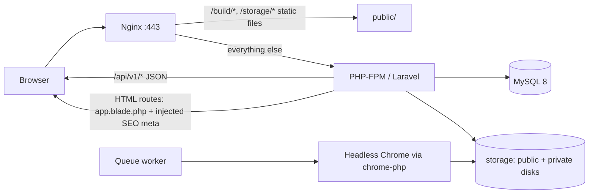

# Architecture — Kaniz Ripa Overseas

Corporate portfolio website + CMS. **Not** a recruitment management system: no applications, applicant accounts, CVs, ATS, interviews or HR features.

## Repository layout

A single Laravel project. The React SPA lives inside it and is built by Laravel's Vite plugin.

```
app/, routes/, database/, config/   Laravel (REST API at /api/v1, Sanctum, MySQL 8)
resources/js/                       React + TypeScript SPA (public site + /admin CMS)
resources/css/app.css               Tailwind entry
resources/views/app.blade.php       SPA shell: @vite + server-injected SEO meta
resources/views/pdf/                Company profile PDF templates
public/build/                       Vite production build output
docs/                               Architecture, database, UI/UX, missing info, deployment, brand assets
```

## Runtime topology (production)



- **Single domain.** The SPA and API share an origin, so Sanctum uses stateful session cookies and CSRF (`/sanctum/csrf-cookie`). No tokens are kept in localStorage and no CORS is needed.
- **SEO for a SPA.** Every non-API HTML route goes to `SpaController`, which renders `app.blade.php` (with `@vite`) and injects `<title>`, description, canonical, `hreflang`, Open Graph/Twitter tags and JSON-LD for the requested route and locale. Crawlers and social previews get correct metadata without a Node SSR server.
- **Locales.** URLs are prefixed with `/en` or `/bn`, and `/` redirects according to `Accept-Language` (default `bn`). Slugs are stored per translation.

## Server side (Laravel)

| Concern | Choice |
|---|---|
| Auth | `laravel/sanctum` (SPA cookie), login throttled |
| RBAC | `spatie/laravel-permission`, permissions named `module.action` |
| Audit | `spatie/laravel-activitylog` on all admin writes and logins |
| PDF | `spatie/laravel-pdf` with the `chrome` driver (`chrome-php/chrome`): PHP drives headless Chrome directly, so the server needs Chrome but **not Node**. Chromium shapes Bangla conjuncts correctly. Fonts are self-hosted in `resources/fonts` and embedded |
| Images | `intervention/image`: re-encode, WebP + responsive variants |
| Sitemap | `spatie/laravel-sitemap` |
| Rich text | `mews/purifier` allow-list |
| Tests | Pest |

Code organisation:

```
app/Enums/                 PublishStatus, Locale, ProfileSource, VerificationStatus, GalleryMediaType, ContactMessageStatus
app/Support/               Permissions (module.action matrix), TranslationRules, TranslationColumns
app/Models/                Eloquent models, HasTranslations concern
app/Http/Controllers/Api/V1/Public/*   read-only, published+reviewed content only
app/Http/Controllers/Api/V1/Admin/*    CRUD (shared CrudController), guarded by auth:sanctum + permission middleware
app/Http/Requests/         FormRequest per write endpoint
app/Http/Resources/        API Resources (public vs admin shapes)
app/Services/              MediaService, ProfilePdfService, SettingsService
app/Jobs/                  GenerateCompanyProfilePdf
resources/views/pdf/       company profile Blade template
```

## Client side (React, `resources/js/`)

```
app/            providers (QueryClient, i18n, router)
routes/         public + admin route trees (lazy)
layouts/        PublicLayout, AdminLayout
features/<m>/   api.ts (TanStack Query hooks), schemas.ts (Zod), components/, pages/
components/ui/  design-system primitives
lib/            api client (axios + XSRF), i18n, seo helpers, formatters
locales/        en.json, bn.json (UI strings only; CMS content comes localized from API)
```

Libraries: React Router, TanStack Query, React Hook Form + Zod, Lucide icons, Tailwind CSS.

## Content and publishing rules

1. Each content type has a base table and a `*_translations` table (`bn`, `en`).
2. A translation is publicly visible only when `is_reviewed = true`. Machine translations are never auto-published.
3. Public endpoints return only `status = published` records. Unverified companies are never shown as partners.
4. Success stories require `consent_confirmed_at` before they can be published.

## Company profile PDF

- **Uploaded:** an official PDF is stored on the private disk as a new `company_profile_versions` row.
- **Generated:** a queued job renders `pdf/profile.blade.php` per locale (A4, header/footer, page numbers, embedded EN/BN fonts) and stores the result as a version.
- `company_profiles.active_source` (`uploaded` | `generated`) together with the current version decides what the public download returns. Files are always streamed by a controller, never linked by path.

## Security summary

Sanctum + CSRF, RBAC on every admin route, FormRequest validation, Eloquent bindings only, HTML purification, upload allow-lists with re-encoding and random names, private disk for unpublished files, rate limiting (login, contact form, downloads), activity logging, `.env` secrets, and Nginx security headers.

## API overview (`/api/v1`)

Public (read-only, `?locale=bn|en`): `site`, `home`, `countries`, `industries`, `pages/{key}`, `services[/{slug}]`, `portfolios[/{slug}]` (`?country=MY&industry=&featured=1`), `partners[/{slug}]`, `success-stories[/{slug}]` (`?country=`), `gallery` (`?category=&type=`), `gallery/categories`, `company-profile`, `company-profile/download`, `POST contact`.

Admin (`/admin`, Sanctum cookie): `login`, `logout`, `me`, `dashboard`, `reference`. CRUD for `pages`, `services`, `portfolios`, `companies`, `success-stories`, `gallery-categories`, `gallery-items`, `countries`. Also `media`, `company-profile` (upload, generate, preview, versions), `contact-messages`, `menus`, `seo`, `settings`, `users`, `roles`, `activity-logs`. Run `php artisan route:list --path=api` for the full list.

Publishing safeguards enforced server-side:
- Changing anything to or from `published` requires `{module}.publish`.
- Verifying a company or showing it as a partner requires `companies.publish`.
- Success stories cannot be published without `consent_confirmed` + `consent_note`.
- The company profile cannot be published until the active source has a current version.
