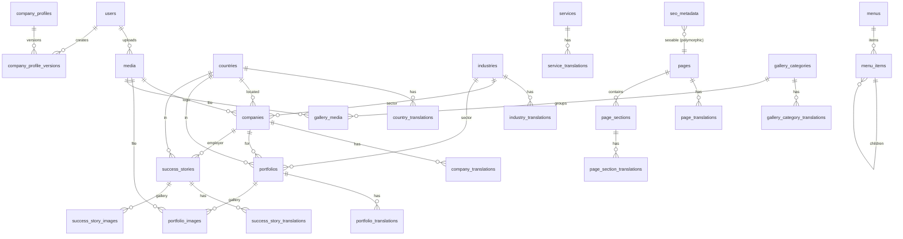

# Database Design

MySQL 8, `utf8mb4_unicode_ci`. Locales: `bn`, `en`.

Translatable entities use a **base table** for language-neutral fields and a **`*_translations`** table with `(parent_id, locale)` unique, plus `is_reviewed`, `reviewed_by` and `reviewed_at`.

Changes from the suggested table list:
- `partner_companies` is merged into `companies` (`verification_status` + `is_partner_displayed`). A partner is a verified company the admin chooses to display. This prevents implying unconfirmed partnerships.
- `testimonials` is merged into `success_story_translations.testimonial`, since a testimonial always belongs to a consented story.
- Added `industries`, `page_sections`, `menu_items`, `success_story_images` and the translation tables for countries, industries, gallery categories and companies.
- `roles`/`permissions` come from spatie/laravel-permission. `activity_logs` is spatie's `activity_log` table.

## ER diagram

## Tables (key columns)

| Table | Columns |
|---|---|
| users | id, name, email (uniq), password, is_active, last_login_at |
| media | id, disk (`public`/`private`), path, original_name, mime, size, width, height, variants JSON, alt JSON {bn,en}, uploaded_by |
| settings | id, group, key (uniq), value JSON, is_translatable, is_placeholder |
| countries | id, iso2 (uniq), is_served, sort |
| country_translations | country_id, locale, name |
| industries / industry_translations | id, sort / name |
| services | id, icon, image_media_id, status, sort |
| service_translations | service_id, locale, title, slug, summary, body, is_reviewed… |
| pages | id, key (uniq: about, mission, vision, values, history, management, credentials, home_intro, why_choose_us), status |
| page_translations | page_id, locale, title, slug, body, is_reviewed… |
| page_sections / page_section_translations | page_id, key, media_id, sort / title, body |
| companies | id, name, logo_media_id, country_id, industry_id, website_url, verification_status, is_partner_displayed, sort |
| company_translations | company_id, locale, description, is_reviewed… |
| portfolios | id, company_id, country_id, industry_id, cover_media_id, project_date, is_featured, status, sort |
| portfolio_translations | portfolio_id, locale, title, slug, summary, description, activities, is_reviewed… |
| portfolio_images | portfolio_id, media_id, caption JSON, sort |
| success_stories | id, photo_media_id, country_id, company_id, industry_id, video_url, is_featured, status, consent_confirmed_at, consent_note |
| success_story_translations | story_id, locale, title, slug, display_name, story, testimonial, is_reviewed… |
| success_story_images | story_id, media_id, sort |
| gallery_categories / translations | id, slug, sort / name |
| gallery_media | id, category_id, type (image/video), media_id, video_url, title JSON, status, sort |
| company_profiles | id (singleton), active_source, status, title JSON, description JSON |
| company_profile_versions | id, company_profile_id, source, locale, disk, path, size, version_no, is_current, notes, created_by |
| contact_messages | id, name, email, phone, subject, message, ip, user_agent, read_at, status |
| menus / menu_items | id, location / menu_id, parent_id, label JSON, route_name, url, sort, is_active |
| seo_metadata | seoable_type, seoable_id, locale, meta_title, meta_description, og_image_media_id, canonical_url, noindex |

Status enums: `draft`, `published`, `archived`. Verification: `unverified`, `verified`.

Indexes: `(status, is_featured, sort)` on listing tables, unique `(locale, slug)` on translation tables, and FKs indexed.

## Seed policy

Seed only verified data:
- roles and permissions
- the first admin (credentials from `.env`)
- countries and industries
- contact settings taken from the official posters
- companies seen on posters as **unverified**
- portfolio entries as **draft**

Missing values are seeded as settings with `is_placeholder = true` so the admin dashboard can list them.
